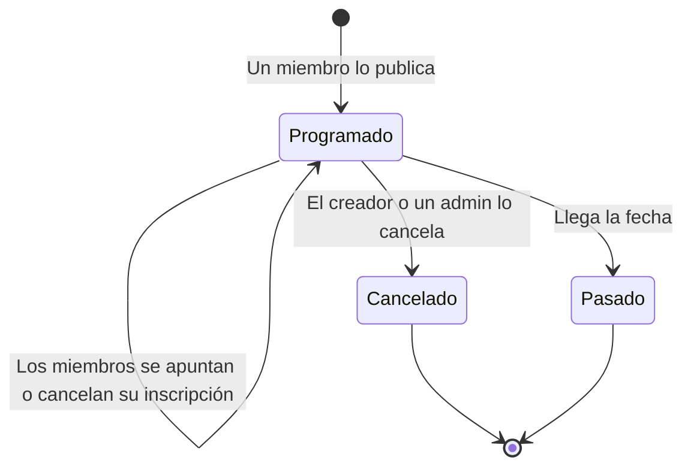

# Módulo de Eventos

> Encuentros, charlas y actividades que organizan los propios miembros, con una lista de asistentes pública.

Este documento explica cómo funciona el módulo de eventos de Agora DAO: para qué sirve, quién puede publicar y apuntarse, qué datos lleva un evento, y qué garantías tiene.

**Contenido**

- [Qué es y para qué sirve](#qué-es-y-para-qué-sirve)
- [Un ejemplo completo](#un-ejemplo-completo)
- [Quién puede hacer qué](#quién-puede-hacer-qué)
- [Qué lleva un evento](#qué-lleva-un-evento)
- [El recorrido de un evento](#el-recorrido-de-un-evento)
- [Qué no hace (todavía)](#qué-no-hace-todavía)
- [Seguridad](#seguridad)
- [Estado del módulo](#estado-del-módulo)
- [Para desarrolladores](#para-desarrolladores)

## Qué es y para qué sirve

Una DAO necesita un lugar donde anunciar cuándo se junta: un meetup, una charla, una videollamada. El módulo de eventos permite publicarlos y saber **quién va a asistir**.

La idea en una frase: una cartelera de eventos de la DAO, con lista de asistentes pública y verificable en la blockchain.

## Un ejemplo completo

> **Alice** quiere organizar un meetup para charlar del futuro de la DAO.

1. Alice, miembro de la DAO, publica el evento: título «Meetup de noviembre», fecha y hora, lugar («Café de la Esquina, calle Ejemplo 5»), cupo de 20 y una descripción con la agenda.
2. **Bob**, otro miembro, se apunta pulsando **«Apuntarme»**. Su wallet se añade a la lista pública.
3. **Carol** se apunta también. La tarjeta muestra «2 de 20».
4. Dos días antes, Bob se da cuenta de que no puede ir y pulsa **«Cancelar inscripción»**. Se abre un hueco para otro.
5. Alice ve en la página quién va a ir y organiza las sillas y la comida en consecuencia.

Si Alice tuviera que cancelar el meetup (por lluvia, por ejemplo), pulsa **«Cancelar el evento»**. Los apuntados ven el evento marcado como **cancelado** y saben que no se celebra.

## Quién puede hacer qué

| Rol en la DAO | Qué puede hacer |
|---|---|
| **Miembro** (incluido el administrador) | Publicar eventos, apuntarse y cancelar su inscripción |
| **Administrador** | Además, cancelar cualquier evento (como moderador) |
| **Creador de un evento** | Cancelar su propio evento |
| **Cualquier persona** | Ver la lista de eventos y los asistentes |

**Decisión importante:** inscribirse requiere ser miembro de la DAO. "Evento público" aquí significa que lo organiza la DAO y la lista de asistentes es visible, no que cualquier wallet pueda apuntarse. Para abrir inscripciones a gente que no es miembro haría falta una página pública con su propio diseño; no existe hoy.

## Qué lleva un evento

Al publicarlo, el creador completa estos datos:

| Dato | Detalle |
|---|---|
| **Título** | Hasta 100 caracteres |
| **Resumen** | Hasta 300 caracteres. Es lo que se ve en la tarjeta |
| **Fecha y hora** | De una hora en el futuro hasta dos años |
| **Ubicación** | Texto libre (hasta 200 caracteres): dirección física o enlace a videollamada |
| **Capacidad** | Número máximo de asistentes. 0 = sin límite |
| **Portada** | Imagen opcional (JPG o PNG, menos de 1 MB) |
| **Descripción** | Opcional, con Markdown: títulos, listas, enlaces, tablas, listas de tareas... |

La portada y la descripción son opcionales: un evento se puede publicar solo con lo básico y sin tocar ningún archivo. Si se añaden, se guardan en un archivo con una huella SHA-256 que la blockchain registra; cualquier alteración posterior se detecta.

## El recorrido de un evento



- **Programado** y **Cancelado** son los dos estados que guarda el contrato.
- **Pasado** se calcula a partir de la fecha: no hay transición explícita.
- Un evento cancelado antes del horario sigue mostrándose en la lista con su etiqueta «Cancelado» para que los apuntados sepan por qué no se celebra.
- Las inscripciones no se pueden cambiar ni cancelar después de la hora de inicio.

## Qué no hace (todavía)

- **Solo miembros se inscriben.** Para abrir eventos a gente que no está en la DAO haría falta una página pública (como una landing para visitantes).
- **Sin entrada de pago.** Los eventos son gratis. Si quisieras cobrar, habría que gestionar reembolsos cuando se cancelan, y eso es otro módulo.
- **Sin lista de espera.** Si se llena, no se puede añadir a nadie más. Hay que esperar a que alguien cancele para que se abra un hueco.
- **Sin recordatorios.** No se envían avisos ni se marcan en calendarios automáticamente. El miembro tiene que mirar la lista.
- **Sin check-in de asistencia on-chain.** La blockchain guarda quién dijo que iría. Si alguien se apunta y luego no va, el contrato no lo sabe.
- **Sin eventos recurrentes.** Cada uno se publica por separado.
- **Sin categorías ni etiquetas.**
- **Todo es público.** Título, descripción y la lista completa de wallets inscritas quedan visibles para cualquiera.

## Seguridad

### Las reglas vienen del contrato
Como en los otros módulos, el contrato hace cumplir las reglas; la página solo evita ofrecer botones que fallarían. Si alguien ignora la página y habla directo con el contrato, choca con las mismas reglas.

### Protecciones concretas

| Riesgo | Cómo se evita |
|---|---|
| Alguien se inscribe sin ser miembro | El contrato comprueba el rol en vivo con la DAO |
| Alguien se inscribe dos veces para inflar el aforo | Un `mapping` guarda quién ya se apuntó; una segunda llamada revierte |
| Publicar eventos en el pasado o a 50 años vista | Fecha obligatoria: al menos una hora en el futuro, como mucho dos años |
| Cancelar un evento ajeno | Solo el creador o un administrador pueden cancelar |
| Modificar el título o la descripción después de publicarlo | Los datos on-chain no se pueden editar. La descripción en el archivo tampoco: su huella queda en la blockchain |
| Pasarse del cupo | El contrato cuenta los asistentes y rechaza nuevos cuando se alcanza el máximo |
| Cancelar inscripción después del evento | El contrato comprueba que la fecha aún no haya llegado |

### Lo que no protege
- **Ir o no ir.** La lista refleja quién dijo que iría, no quién fue de verdad.
- **Spam.** Cualquier miembro puede publicar eventos. Si molesta, un administrador los cancela (los datos se quedan, pero marcados como cancelados).
- **Disponibilidad de los archivos.** Las portadas y descripciones viven en el almacenamiento que opera la plataforma. Quien lo administre puede borrarlas (no alterarlas sin que se note). Los eventos sin portada ni descripción no dependen del almacenamiento.

### Cómo se comprobó
32 pruebas automáticas: creación con cada regla (texto, fechas, cupo), inscripciones (segunda registración, miembro vs. extraño, aforo lleno), cancelación de inscripción (de la primera y última posición), cancelación de evento (creador, admin, resto), eventos pasados vs. próximos, y comportamiento sin metadatos.

## Estado del módulo

| | |
|---|---|
| **Contrato inteligente** | Terminado |
| **Pruebas automáticas** | 32 del contrato de eventos (179 entre todos los contratos) |
| **Interfaz** | Lista, publicación con portada opcional, detalle con lista de asistentes y acciones |
| **Perfil** | Las propuestas y tareas aparecen allí; los eventos aún no, pero se pueden añadir |
| **Auditoría externa de seguridad** | Pendiente |
| **Red** | Solo pruebas locales |

## Para desarrolladores

**Dónde está el código**

- Contrato: [`packages/hardhat/contracts/AgoraEvents.sol`](../../packages/hardhat/contracts/AgoraEvents.sol)
- Pruebas: [`packages/hardhat/test/AgoraEvents.ts`](../../packages/hardhat/test/AgoraEvents.ts)

**Cómo encaja**

- Cada DAO tiene su propio contrato de eventos, creado como clon por el factory junto con la DAO.
- La dirección se obtiene con `AgoraDao.publicEvents()`. El módulo consulta los roles a la DAO con `isRole`. (Se llama `publicEvents` en lugar de `events` porque `events` colisiona con un término reservado del cliente de la blockchain.)

**Funciones principales**

| Función | Quién | Cuándo |
|---|---|---|
| `createEvent(título, resumen, fecha, lugar, cupo, hashDetalles)` | Miembro o admin | Siempre, con una fecha válida |
| `register(id)` | Miembro o admin | Mientras el evento esté programado y no haya empezado |
| `cancelRegistration(id)` | Quien se inscribió | Antes del inicio |
| `cancelEvent(id)` | Creador o admin | Antes del inicio |

**Lectura:** `getEventById(id)`, `getAllEvents()`, `eventCount()`, `getAttendees(id)`, `attendeeCount(id)`, `isAttending(id, address)`.

**Eventos:** `EventCreated(id, creator, startsAt)`, `EventCancelled(id, by)`, `AttendeeRegistered(id, attendee)`, `AttendeeCancelled(id, attendee)`.

**Metadatos opcionales:** `hashDetalles` es el SHA-256 de un JSON con la forma `{ version: 1, description: string, cover: "<hash>.png" | null }`. Si no hay metadatos se envía `bytes32(0)`.

**Probar**

```bash
cd packages/hardhat
yarn hardhat test test/AgoraEvents.ts --network hardhat
```
