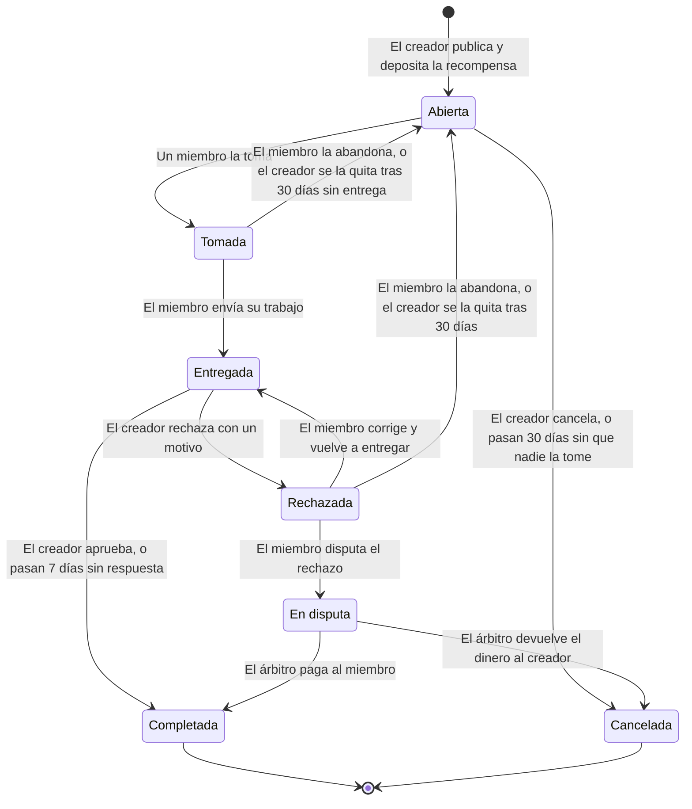

# Módulo de Tareas

> Publica trabajo, paga solo cuando está hecho y deja que la propia blockchain haga cumplir las reglas.

Este documento explica cómo funciona el módulo de tareas de Agora DAO: qué es, cómo fluye una tarea de principio a fin, cuánto dura cada etapa, cómo y cuándo se mueve el dinero, y qué límites tiene hoy.

**Contenido**

- [Qué es y para qué sirve](#qué-es-y-para-qué-sirve)
- [Un ejemplo completo](#un-ejemplo-completo)
- [Qué lleva una tarea](#qué-lleva-una-tarea)
- [Quién puede hacer qué](#quién-puede-hacer-qué)
- [El recorrido de una tarea](#el-recorrido-de-una-tarea)
- [Plazos](#plazos)
- [El dinero](#el-dinero)
- [Cuando algo sale mal](#cuando-algo-sale-mal)
- [Qué no hace (todavía)](#qué-no-hace-todavía)
- [Estado del módulo](#estado-del-módulo)
- [Para desarrolladores](#para-desarrolladores)

## Qué es y para qué sirve

Una DAO necesita que alguien haga cosas: diseñar, programar, escribir, organizar. El módulo de tareas permite que un miembro **publique un trabajo con su recompensa** y que otro miembro **lo tome y lo entregue**. Lo importante es cómo se maneja el dinero:

- La recompensa **se deposita al publicar la tarea** y queda retenida en un contrato inteligente (escrow). Quien trabaja sabe que el dinero existe.
- La recompensa **solo sale cuando se cumplen las reglas**: se paga a quien trabajó cuando el creador aprueba, o se devuelve al creador si nadie hizo el trabajo.
- **Nadie puede quedarse con el dinero a medio camino**: ni el creador, ni el administrador de la DAO, ni nosotros. El contrato no tiene ninguna función de retiro libre ni un dueño con poderes especiales.
- Ningún plazo se queda colgado para siempre. Si alguien no actúa, la tarea avanza o el dinero vuelve a su dueño.

## Un ejemplo completo

> **Juan** necesita una landing page para su proyecto. **Ana** es diseñadora y miembro de la misma DAO.

1. Juan, que tiene el rol de _gestor de tareas_, publica la tarea **«Landing page»** con su descripción, criterios de aceptación y un plazo de entrega de 14 días, y deposita **1 ETH** de recompensa. El dinero queda retenido en el contrato.
2. Ana ve la tarea, la **toma** y empieza a trabajar. Desde ese momento nadie más puede tomarla, y Juan ya no puede cancelarla ni recuperar el dinero por su cuenta.
3. Ana termina el diseño en Figma y **entrega el enlace** con una nota («Revisa el prototipo, incluye versión móvil»).
4. Juan lo revisa y tiene dos caminos:
   - **Aprueba:** el contrato paga **1 ETH a la wallet de Ana en ese mismo instante**. Fin.
   - **Rechaza:** debe escribir el motivo («falta la sección principal»). Ana puede corregir y volver a entregar.
5. Si Ana cree que el rechazo es injusto, abre una **disputa**. Un auditor de la DAO (que no es ni Juan ni Ana) decide si se le paga a Ana o se le devuelve el dinero a Juan.
6. Si Juan simplemente **no responde en 7 días**, Ana puede cobrar igualmente.

## Qué lleva una tarea

Al publicarla, el creador completa un asistente de **3 pasos** (lo básico, detalles, y plazo y recompensa), con una barra de progreso que muestra en qué paso va. Cada paso se valida antes de avanzar. Estos son los datos:

| Dato | Detalle |
|---|---|
| **Título** | Hasta 80 caracteres |
| **Resumen** | Hasta 160 caracteres. Es lo que se ve en la tarjeta de la lista |
| **Categoría** | Desarrollo, Diseño, Contenido, Marketing, Investigación u Otro |
| **Descripción** | Larga, en Markdown como el de GitHub: títulos, negritas, listas, listas de tareas, tablas, citas y bloques de código. Hasta 5.000 caracteres. El editor tiene barra de formato, atajos de teclado (Ctrl+B, Ctrl+I, Ctrl+K), continúa las listas al pulsar Enter y ofrece vista previa |
| **Imágenes** | Opcional. Hasta 3, JPG o PNG de menos de 1 MB: referencias, bocetos, capturas |
| **Criterios de aceptación** | Opcional. Hasta 10 puntos que definen cuándo la tarea está terminada. Si hay una disputa, el árbitro los usa para decidir |
| **Enlaces de referencia** | Opcional. Hasta 5, con nombre (ejemplos, guía de marca...) |
| **Plazo de entrega** | De 7 a 30 días, lo elige el creador. Es el tiempo que tendrá quien tome la tarea, desde que la toma |
| **Recompensa** | En ETH. Se deposita en el momento de publicar |

Antes de pagar, la página muestra cómo se verá la tarjeta y cuánto se va a depositar. Las imágenes escritas dentro de la descripción no se cargan (se muestran como enlace); para adjuntar imágenes está su propio campo.

**Lo acordado no se puede alterar sin que se note.** La descripción, los criterios y los enlaces se guardan en un archivo, y la blockchain guarda su huella digital (SHA-256). Cada vez que alguien abre la tarea, la página calcula la huella del archivo y la compara con la del contrato: si alguien hubiera cambiado una sola letra, no coincidiría y la página se negaría a mostrarlo. Así, en una disputa, el árbitro ve exactamente lo que se pidió, y ninguna de las dos partes puede reescribirlo en silencio. Los archivos viven en Supabase Storage, con el nombre de su huella, de modo que ni siquiera se puede reemplazar uno por otro.

## Quién puede hacer qué

| Rol en la DAO | Qué puede hacer en tareas |
|---|---|
| **Gestor de tareas** | Publicar tareas y cancelarlas mientras estén abiertas |
| **Administrador** | Publicar tareas. También puede ser árbitro de disputas |
| **Miembro** | Tomar tareas, entregar trabajo, abandonar una tarea, disputar un rechazo |
| **Auditor** | Resolver disputas (como árbitro) |
| **Cualquier persona** | Ejecutar un reembolso vencido o un cobro vencido (el dinero siempre va a quien le corresponde) |

Reglas para evitar conflictos de interés:

- El creador **no puede tomar su propia tarea**.
- Quien arbitra una disputa **no puede ser parte de la tarea** (ni el creador ni quien trabajó).

## El recorrido de una tarea



| Estado | Significado | Qué pasa con el dinero |
|---|---|---|
| **Abierta** | Publicada, esperando que alguien la tome | Retenido |
| **Tomada** | Alguien está trabajando en ella | Retenido |
| **Entregada** | El trabajo está esperando la revisión del creador | Retenido |
| **Rechazada** | El creador pidió cambios | Retenido |
| **En disputa** | Un árbitro debe decidir | Retenido |
| **Completada** | Terminada y pagada | **Pagado a quien trabajó** |
| **Cancelada** | Terminada sin trabajo aceptado | **Devuelto al creador** |

Si una tarea vuelve a abrirse (porque el miembro la abandonó o el creador se la quitó), se borra el trabajo anterior y vuelve a empezar con un plazo nuevo de 30 días para que alguien la tome.

## Plazos

Hay tres relojes. Ninguno depende de que alguien «se acuerde»: al vencer, cualquiera puede ejecutar la consecuencia.

| Plazo | Duración | Empieza cuando… | Si vence… |
|---|---|---|---|
| **Que alguien la tome** | **30 días** | Se publica la tarea (o se reabre) | El dinero vuelve al creador. Cualquiera puede ejecutar el reembolso |
| **Entregar el trabajo** | **De 7 a 30 días, los elige el creador** | Alguien toma la tarea (o el creador la rechaza) | El creador puede quitarle la tarea a quien no entregó, y se reabre. Mientras no se la quite, el miembro todavía puede entregar |
| **Revisar la entrega** | **7 días** | Se entrega el trabajo | Quien trabajó puede cobrar. El creador ya no puede rechazar |

**Cuánto dura una tarea después de aceptada:** quien la toma tiene el **plazo de entrega que fijó el creador al publicarla (entre 7 y 30 días)**. Al tomarla, el reloj de «que alguien la tome» se apaga por completo. Si el creador la rechaza, el plazo de corrección es el mismo.

Los plazos se miden con la hora de la blockchain, que puede diferir unos segundos de la hora real.

## El dinero

**Moneda:** ETH (la moneda nativa de la red). Por ahora no hay otras monedas ni stablecoins.

**Cómo funciona el escrow**

1. Al publicar la tarea, el creador envía la recompensa junto con la transacción. Queda guardada en el contrato **de esa DAO** (cada DAO tiene su propio contrato de tareas, así que los fondos de una DAO nunca se mezclan con los de otra).
2. El contrato lleva la cuenta de cuánto corresponde a cada tarea. El dinero de una tarea solo puede salir por los caminos de las reglas.

**Cómo recibe el dinero quien trabaja**

- Cuando el creador aprueba, el contrato **envía la recompensa directamente a la wallet con la que tomó la tarea**, en esa misma transacción. No hay que pedir un retiro, ni esperar a nadie, ni pasar por una cuenta intermedia.
- Si el creador no responde en 7 días, quien trabajó (o cualquier persona por él) ejecuta «cobrar» y el dinero llega igual a su wallet.
- Si hay disputa y el árbitro falla a su favor, el pago llega a su wallet cuando el árbitro lo decide.

**Cómo recupera el dinero el creador**

- Cancelando la tarea mientras esté **abierta**.
- Si nadie la toma en **30 días** (cualquiera puede ejecutar el reembolso).
- Si **gana una disputa**: el árbitro ordena devolverle el dinero.

**Comisiones:** el contrato **no cobra comisión**. Lo único que se paga es la tarifa de red (gas) de cada transacción, y la paga quien la envía. Por ejemplo, al aprobar, esa tarifa la paga el creador, y quien trabajó recibe la recompensa completa.

## Cuando algo sale mal

| Situación | Qué ocurre |
|---|---|
| **Nadie toma la tarea** | A los 30 días el dinero se devuelve al creador |
| **Quien tomó la tarea desaparece** | Al vencer el plazo de entrega, el creador se la quita y se reabre para otro. También puede abandonarla el propio miembro cuando quiera |
| **El creador desaparece tras recibir el trabajo** | A los 7 días, quien trabajó cobra |
| **El creador rechaza el trabajo sin razón** | Quien trabajó abre una disputa y un árbitro decide |
| **Creador y trabajador no se ponen de acuerdo** | Decide un auditor o administrador que no es parte de la tarea |
| **El creador se arrepiente** | Solo puede cancelar mientras la tarea esté abierta. Una vez tomada, el dinero queda comprometido con quien trabaja |
| **Alguien intenta cobrar dos veces** | El contrato lo rechaza: una tarea terminada ya no se puede usar |

## Qué no hace (todavía)

Conviene conocer estos límites antes de usarlo o de ofrecerlo:

- **Solo ETH.** No hay pagos en tokens ni stablecoins.
- **No se puede editar una tarea publicada.** Si hay un error, se cancela (mientras esté abierta) y se vuelve a crear.
- **Un solo responsable por tarea.** No hay trabajo en equipo ni pagos divididos.
- **Pago completo o ninguno.** No hay pagos parciales por hitos.
- **Las categorías son una lista fija** de seis. No hay prioridad por tarea ni un chat para conversarla; están pensados para más adelante.
- **Todo es público.** Títulos, descripciones, imágenes, enlaces de entrega y motivos de rechazo quedan visibles para cualquiera, en la blockchain o en el almacenamiento de archivos. Por eso no deben incluirse datos confidenciales; los enlaces a archivos (Figma, Drive...) deben tener sus propios permisos de acceso.
- **Quien controle el almacenamiento puede dejar de servir un archivo.** No puede alterarlo sin que se detecte, pero sí borrarlo, y entonces la página mostraría que no se pueden leer los detalles. Por eso conviene hacer copias de seguridad del bucket. Además, si alguien sube sus archivos y luego cancela la transacción en su wallet, los archivos quedan guardados sin usarse.
- **Subir archivos requiere una firma.** El creador firma un mensaje con su wallet (no cuesta gas) para autorizar la subida, y el servidor comprueba en la blockchain que sea gestor de tareas o administrador de esa DAO.
- **Las disputas necesitan un árbitro disponible.** Si el administrador es quien creó la tarea y la DAO no tiene ningún auditor, nadie puede arbitrar. Se recomienda que toda DAO tenga al menos un auditor distinto de quien crea tareas.
- **Sin recuperación de wallet.** Quien pierde acceso a su wallet pierde lo que le corresponde. Es una propiedad de la blockchain, no del módulo.

## Estado del módulo

| | |
|---|---|
| **Contrato inteligente** | Terminado |
| **Perfil** | Incluye «Mis tareas»: las que publicaste y las que tienes a tu cargo |
| **Pruebas automáticas** | 60 pruebas que cubren el flujo completo, los plazos, los permisos y los casos límite |
| **Interfaz: publicar y ver tareas** | Lista, buscador y filtros por estado y categoría, y página para publicar una tarea |
| **Interfaz: trabajar una tarea** | Página de detalle con el contenido, el progreso y un panel que ofrece a cada persona solo lo que puede hacer en ese estado: tomar, entregar, aprobar, pedir cambios, disputar, resolver, cobrar, cancelar y reembolsar. Las acciones que mueven dinero piden confirmación |
| **Auditoría externa de seguridad** | Pendiente. Recomendable antes de usar con dinero real |
| **Red** | Solo pruebas locales. Aún no desplegado en una red pública |

## Para desarrolladores

**Dónde está el código**

- Contrato: [`packages/hardhat/contracts/AgoraTasks.sol`](../../packages/hardhat/contracts/AgoraTasks.sol)
- Pruebas: [`packages/hardhat/test/AgoraTasks.ts`](../../packages/hardhat/test/AgoraTasks.ts). Sirven como especificación: cada regla de este documento tiene su prueba.
- Los ids de rol: [`packages/hardhat/contracts/shared/RoleIds.sol`](../../packages/hardhat/contracts/shared/RoleIds.sol)

**Cómo encaja**

- Cada DAO es un clon (EIP-1167) de `AgoraDao`, y su módulo de tareas es un clon de `AgoraTasks`. El factory crea ambos en la misma transacción.
- La dirección del módulo se obtiene con `AgoraDao.tasks()`. El módulo consulta los roles a la DAO con `isRole`.

**Funciones principales**

| Función | Quién | Cuándo |
|---|---|---|
| `createTask(título, resumen, categoría, díasDeEntrega, huellaDetalles)` _(payable)_ | Gestor de tareas o admin | Siempre. La recompensa es el ETH enviado |
| `takeTask(id)` | Miembro (no el creador) | Tarea abierta y dentro de los 30 días |
| `submitWork(id, enlace, nota)` | Quien la tomó | Tomada o rechazada |
| `approveWork(id)` | Creador | Entregada |
| `rejectWork(id, motivo)` | Creador | Entregada y dentro de los 7 días |
| `disputeRejection(id)` | Quien la tomó | Rechazada |
| `resolveDispute(id, pagarAlMiembro)` | Auditor o admin que no es parte | En disputa |
| `claimPayment(id)` | Cualquiera | Entregada y pasados los 7 días |
| `cancelTask(id)` | Creador | Abierta |
| `refundExpired(id)` | Cualquiera | Abierta y pasados los 30 días |
| `abandonTask(id)` | Quien la tomó | Tomada o rechazada |
| `unassignTask(id)` | Creador | Tomada o rechazada y pasados los 30 días |

**Lectura:** `getTask(id)`, `getAllTasks()`, `taskCount()`.

**Eventos:** `TaskCreated(id, creator, reward)` y `TaskStatusChanged(id, status, actor)`. Con ellos se arma el historial de actividad sin guardar nada extra.

**Límites de texto:** título 80 caracteres, resumen 160, enlace de entrega 300, nota 300, motivo de rechazo 300. Categorías: ids de 0 a 5 (los nombres viven en `packages/nextjs/constants/taskCategories.ts`). Días de entrega: de 7 a 30.

**Los detalles fuera de la cadena:** `huellaDetalles` es el SHA-256 de un archivo JSON que arma el frontend con esta forma. El archivo se guarda con ese mismo hash como nombre (`<hash>.json`) en el bucket `task-details`:

```json
{
  "version": 1,
  "description": "Texto largo en Markdown",
  "images": ["<hash>.png"],
  "criteria": ["Se ve bien en móvil"],
  "links": [{ "label": "Guía de marca", "url": "https://..." }]
}
```

El contrato no lee ese JSON: solo guarda su huella. Las imágenes se guardan en el bucket `task-images`, también con su hash como nombre. El esquema que valida el contenido está en [`packages/nextjs/lib/schemes/task.scheme.ts`](../../packages/nextjs/lib/schemes/task.scheme.ts), y la página de publicar en [`packages/nextjs/app/task/new`](../../packages/nextjs/app/task/new).

**Probar**

```bash
cd packages/hardhat
yarn hardhat test test/AgoraTasks.ts --network hardhat
```
