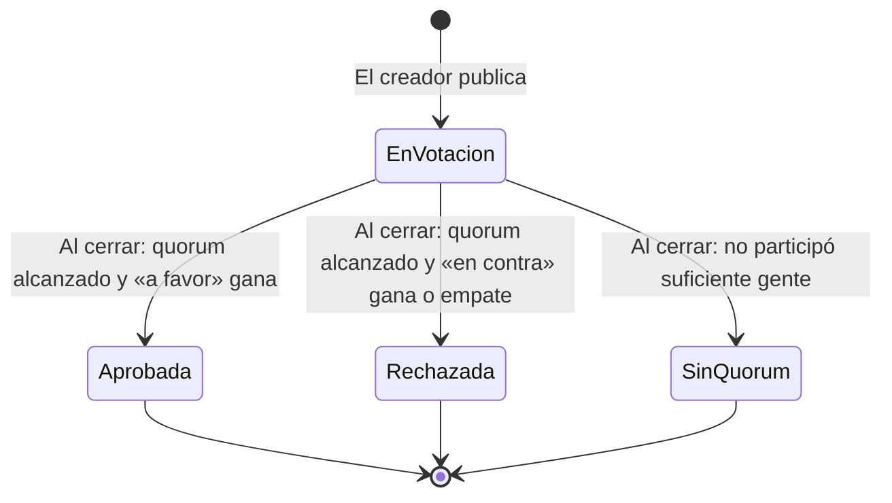

# Módulo de Votaciones

> Deja que los miembros decidan juntos y que la decisión quede escrita en la blockchain.

Este documento explica cómo funciona el módulo de votaciones de Agora DAO: para qué sirve, cómo se publica una propuesta, cómo se vota, qué se necesita para que una propuesta se apruebe y qué límites tiene hoy.

**Contenido**

- [Qué es y para qué sirve](#qué-es-y-para-qué-sirve)
- [Un ejemplo completo](#un-ejemplo-completo)
- [Quién puede hacer qué](#quién-puede-hacer-qué)
- [Qué lleva una propuesta](#qué-lleva-una-propuesta)
- [Cómo se decide: mayoría y quorum](#cómo-se-decide-mayoría-y-quorum)
- [El recorrido de una propuesta](#el-recorrido-de-una-propuesta)
- [Qué no hace (todavía)](#qué-no-hace-todavía)
- [Seguridad](#seguridad)
- [Estado del módulo](#estado-del-módulo)
- [Para desarrolladores](#para-desarrolladores)

## Qué es y para qué sirve

Una DAO toma decisiones de grupo: ¿hacemos un evento?, ¿cambiamos esta regla?, ¿cómo nos organizamos? El módulo de votaciones permite publicar una propuesta, abrir un plazo para que los miembros voten y registrar el resultado de forma pública e inmutable.

**La idea en una frase:** cualquiera lee lo que se votó, cómo votó cada quién y qué se decidió, sin tener que confiar en nadie que lo cuente.

## Un ejemplo completo

> **Marta** es gestora de propuestas de una DAO con 10 miembros. Quiere saber si organizan un meetup presencial en noviembre.

1. Marta publica la propuesta **«Organizar un meetup en noviembre»** con una descripción (en Markdown) y elige **7 días** de votación.
2. Los miembros entran, leen la propuesta y votan: **a favor**, **en contra** o **abstención**. Cada wallet vota una sola vez.
3. En tiempo real, la propuesta muestra el reparto y cuántos miembros faltan para alcanzar el quorum.
4. Cuando terminan los 7 días, cualquiera puede pulsar **«Cerrar la votación»**. El contrato calcula el resultado:
   - **Aprobada** si votó al menos el 20% de los miembros y «a favor» le ganó a «en contra».
   - **Rechazada** si votó al menos el 20% pero no ganó «a favor».
   - **Sin quorum** si no participó suficiente gente.

El resultado queda registrado en la blockchain y es visible para siempre.

## Quién puede hacer qué

| Rol en la DAO | Qué puede hacer en votaciones |
|---|---|
| **Gestor de propuestas** | Publicar propuestas |
| **Administrador** | Publicar propuestas y votar en ellas |
| **Miembro** | Votar |
| **Auditor** | Nada por defecto (si también es miembro, puede votar) |
| **Cualquier persona** | Cerrar una votación cuyo plazo ya terminó |

Reglas importantes:
- **El creador de una propuesta sí puede votar en ella.** Es un miembro más.
- **Nadie puede votar dos veces** por la misma propuesta.
- **Nadie puede cambiar su voto**, para evitar presiones y manipulación.

## Qué lleva una propuesta

| Dato | Detalle |
|---|---|
| **Título** | Hasta 100 caracteres. Es lo que se ve en la lista |
| **Descripción** | Hasta 2.000 caracteres, en Markdown (como el de GitHub): títulos, negritas, listas, listas de tareas, tablas, citas, enlaces y bloques de código. El editor tiene barra de formato y vista previa |
| **Días de votación** | Entre **3 y 14 días**, lo elige el creador |

**Lo que se publica no se puede cambiar.** Todo vive en la blockchain, así que una vez publicada la propuesta nadie puede editar su título ni su descripción, ni siquiera el creador.

## Cómo se decide: mayoría y quorum

**Mayoría simple.** Para aprobarse, los votos «a favor» deben ser **estrictamente más** que los votos «en contra». Un empate se cuenta como rechazo.

**Quorum.** Debe participar al menos el **20% de los miembros de la DAO**. El denominador se congela cuando se publica la propuesta: si entran miembros nuevos durante la votación, el quorum no se mueve. Así se evita que entrar en masa sabotee una votación en curso.

**Qué cuenta para el quorum.** Los tres tipos de voto (a favor, en contra y abstención) cuentan igual para el quorum. Eso le da sentido a la abstención: una forma de participar sin apoyar ni rechazar, pero contribuyendo al quorum.

**Ejemplo con 10 miembros:**

| Votos a favor | En contra | Abstención | Total | ¿Resultado? |
|---|---|---|---|---|
| 1 | 0 | 0 | 1 | **Sin quorum** (hacen falta 2) |
| 2 | 0 | 0 | 2 | **Aprobada** |
| 1 | 1 | 0 | 2 | **Rechazada** (empate) |
| 0 | 0 | 3 | 3 | **Rechazada** (0 a favor no supera a 0 en contra) |
| 3 | 2 | 1 | 6 | **Aprobada** |

## El recorrido de una propuesta



El cierre no es automático: alguien tiene que llamar a «cerrar la votación» después del plazo. Puede hacerlo cualquiera (no cuesta nada aparte del gas de la transacción).

## Qué no hace (todavía)

Conviene conocer estos límites antes de usarlo:

- **Solo propuestas de texto.** Una propuesta aprobada queda registrada, pero el contrato no ejecuta nada por sí mismo. Si se vota «cambiar X parámetro», alguien con permisos tiene que ir a cambiarlo. Las propuestas que **ejecutan** acciones (por ejemplo, un pago desde la Tesorería) llegarán con el módulo de Tesorería.
- **Un voto por wallet, pesan todos lo mismo.** No hay voto ponderado por reputación ni por tokens.
- **Mayoría simple y quorum fijo del 20%.** Un día se podrá cambiar al crear la DAO; hoy es igual para todas.
- **Nada de delegación.** No se puede delegar el voto en otro miembro.
- **Nada de cambiar el voto.** Una vez emitido, se queda así.
- **Sin chat ni comentarios.** La propuesta se discute fuera de la plataforma.
- **Todo es público.** El voto de cada wallet queda registrado en la blockchain y es visible para siempre.
- **No se puede cancelar una propuesta.** Si hay un error, hay que esperar al cierre y publicar otra.

## Seguridad

### Las reglas vienen del contrato
El contrato es quien hace cumplir todas las reglas (plazos, permisos, un voto por wallet). Si alguien intentara saltarse la página, chocaría igual con las mismas reglas.

### Permisos
- **Publicar:** solo gestores de propuestas o administradores.
- **Votar:** solo miembros o administradores. Un auditor que no se haya unido como miembro no puede votar.
- **Cerrar la votación:** cualquiera, pero solo después de que termine el plazo.

### Protecciones concretas

| Riesgo | Cómo se evita |
|---|---|
| Votar dos veces | El contrato guarda quién ha votado en cada propuesta y rechaza una segunda vez |
| Cambiar el voto en el último momento | Una vez emitido, no se puede cambiar |
| Entrar en masa para subir el quorum | El denominador del quorum se congela al publicar la propuesta |
| Votar fuera de plazo | El contrato rechaza votos después del plazo |
| Cerrar antes de tiempo | El contrato rechaza el cierre antes del plazo |
| Cerrar dos veces | Una propuesta cerrada ya no es «En votación», así que no vuelve a cerrarse |
| Perder el voto por un error de rol | Los permisos los consulta el contrato en vivo; si se quita el rol, el voto futuro deja de permitirse |

### Lo que no protege
- **No evita acuerdos previos.** Si varias wallets pertenecen a la misma persona, puede inflar su peso. Esto se mitigará cuando llegue la Reputación (voto ponderado).
- **La abstención cuenta para el quorum, pero no decide.** Si todos abstienen, la propuesta se **rechaza** (no hay más «a favor» que «en contra»).

### Cómo se comprobó
26 pruebas automáticas que cubren permisos, plazos, el conteo con mayoría estricta, el quorum (incluidos los bordes al 19,99% y al 20%), la abstención, la revocación de roles durante una votación y los intentos de cerrar o votar dos veces.

## Estado del módulo

| | |
|---|---|
| **Contrato inteligente** | Terminado |
| **Pruebas automáticas** | 26 del contrato de votaciones (130 entre todos los contratos) |
| **Interfaz** | Lista, publicación, detalle con votación y cierre |
| **Perfil** | Incluye «Mis propuestas»: las que publicaste en la DAO |
| **Auditoría externa de seguridad** | Pendiente. Recomendable antes de usar con grupos grandes o decisiones de dinero real |
| **Red** | Solo pruebas locales. Aún no desplegado en una red pública |

## Para desarrolladores

**Dónde está el código**

- Contrato: [`packages/hardhat/contracts/AgoraVotes.sol`](../../packages/hardhat/contracts/AgoraVotes.sol)
- Pruebas: [`packages/hardhat/test/AgoraVotes.ts`](../../packages/hardhat/test/AgoraVotes.ts). Sirven como especificación: cada regla de este documento tiene su prueba.
- Ids de rol compartidos: [`packages/hardhat/contracts/shared/RoleIds.sol`](../../packages/hardhat/contracts/shared/RoleIds.sol)

**Cómo encaja**

- Como el resto de módulos, cada DAO tiene su propio contrato de votaciones, creado como clon (EIP-1167) por el factory junto con la DAO.
- La dirección del módulo se obtiene con `AgoraDao.votes()`. El módulo consulta los roles a la DAO con `isRole`, y el número de miembros con `userCounter`.

**Funciones principales**

| Función | Quién | Cuándo |
|---|---|---|
| `createProposal(título, descripción, díasDeVotación)` | Gestor de propuestas o admin | Siempre |
| `castVote(id, choice)` | Miembro o admin | Mientras la propuesta esté activa y el plazo no haya vencido |
| `finalize(id)` | Cualquiera | Propuesta activa cuyo plazo ya venció |

**Lectura:** `getProposal(id)`, `getAllProposals()`, `proposalCount()`, `getVote(id, address)`.

**Eventos:** `ProposalCreated(id, creator, votingDeadline)`, `VoteCast(id, voter, choice)`, `ProposalStatusChanged(id, status)`.

**Opciones de voto** (enum `Choice`): `0 = Against`, `1 = For`, `2 = Abstain`.

**Estados** (enum `Status`): `0 = Active`, `1 = Approved`, `2 = Rejected`, `3 = QuorumNotReached`.

**Límites:** título 100 caracteres, descripción 2.000, días de votación entre 3 y 14, quorum 20%.

**Probar**

```bash
cd packages/hardhat
yarn hardhat test test/AgoraVotes.ts --network hardhat
```
